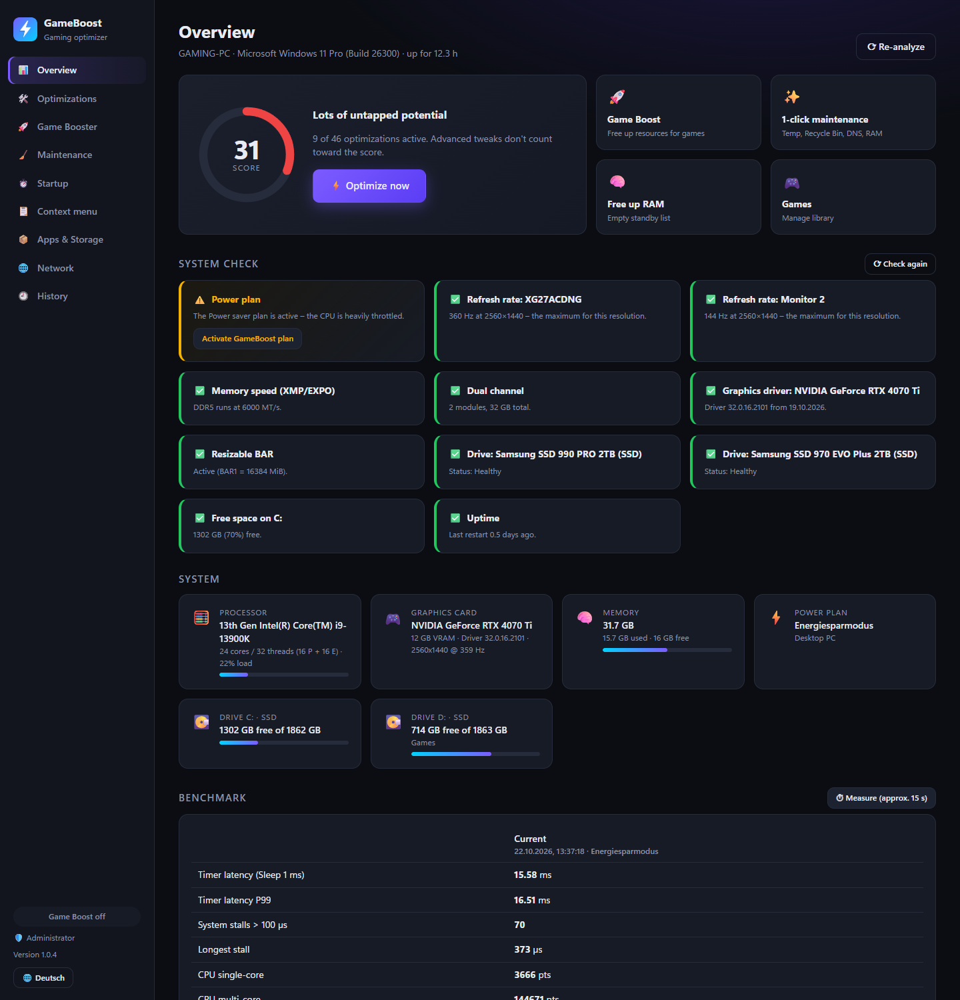
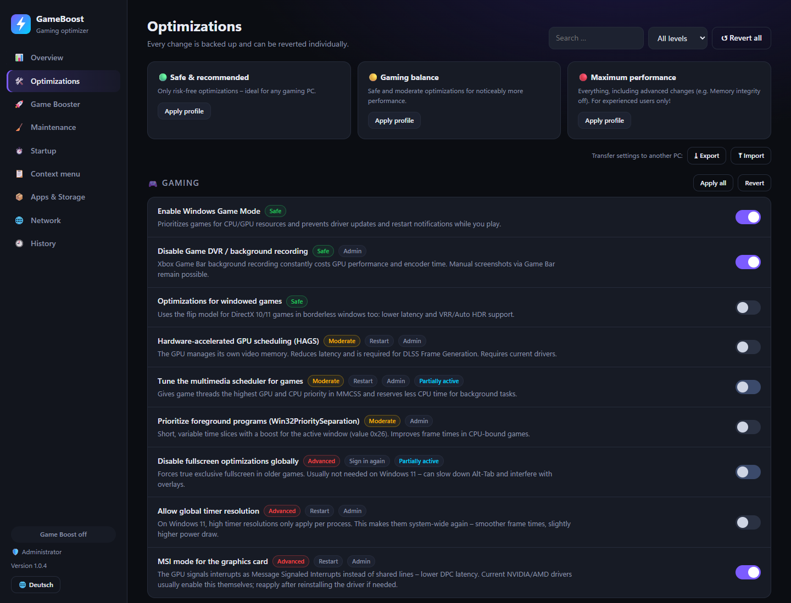
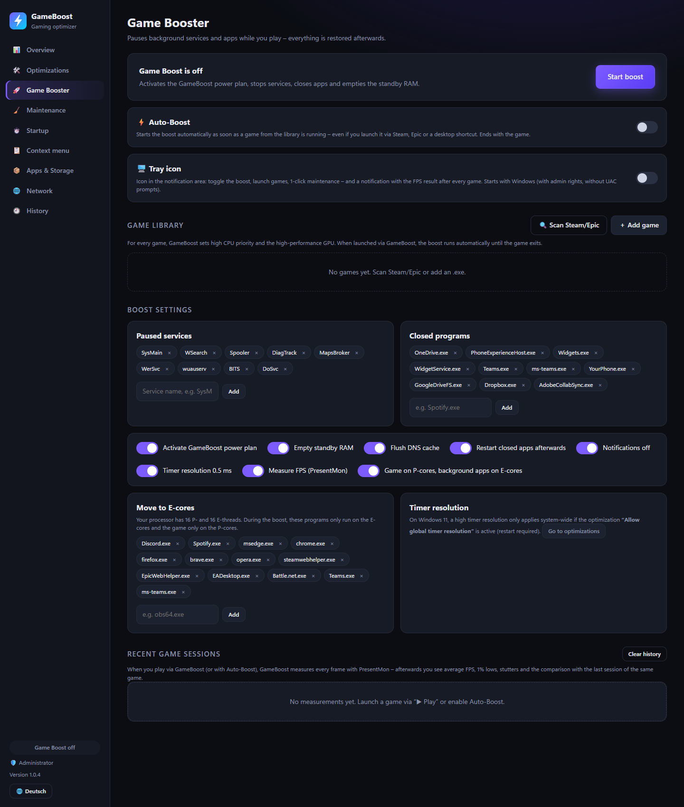
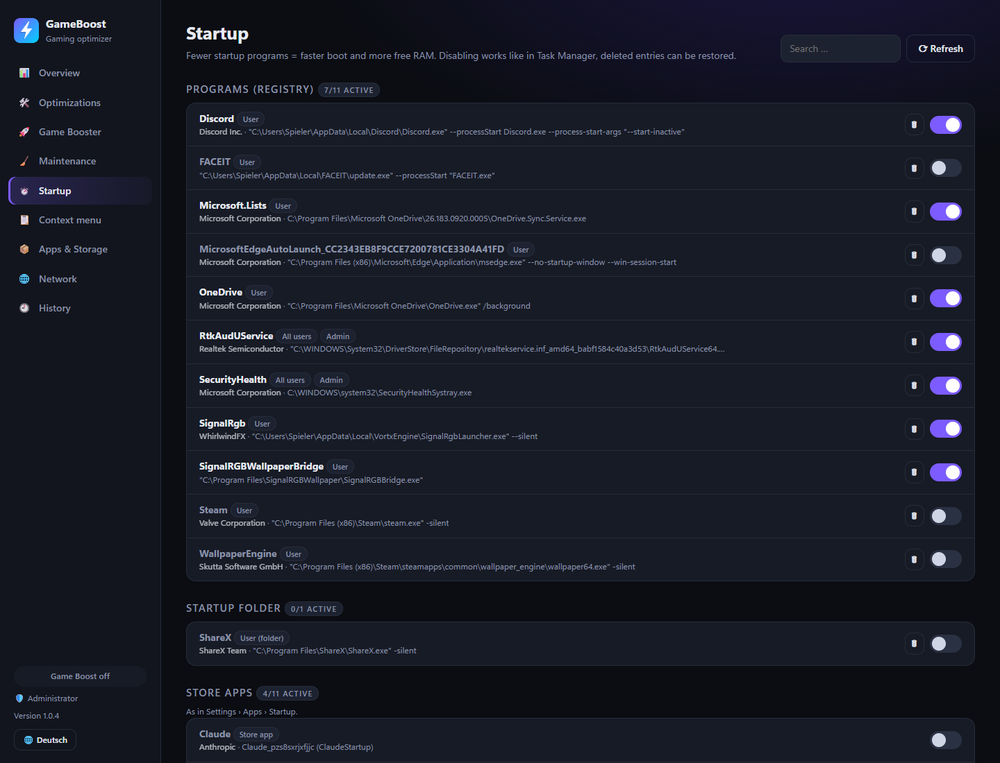
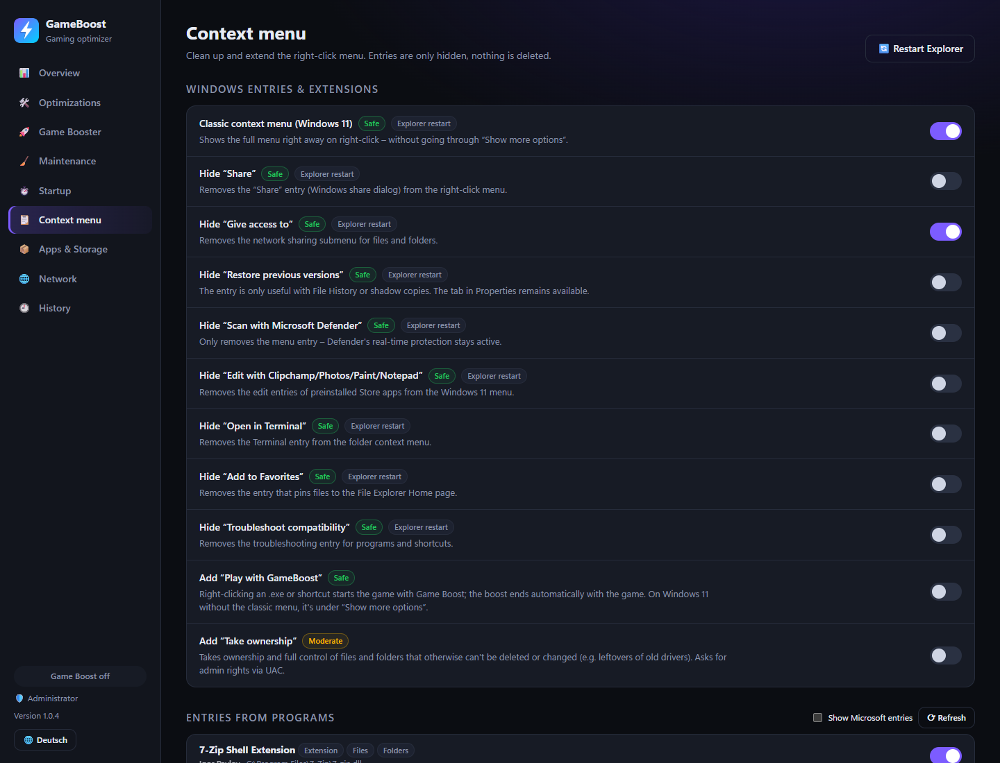
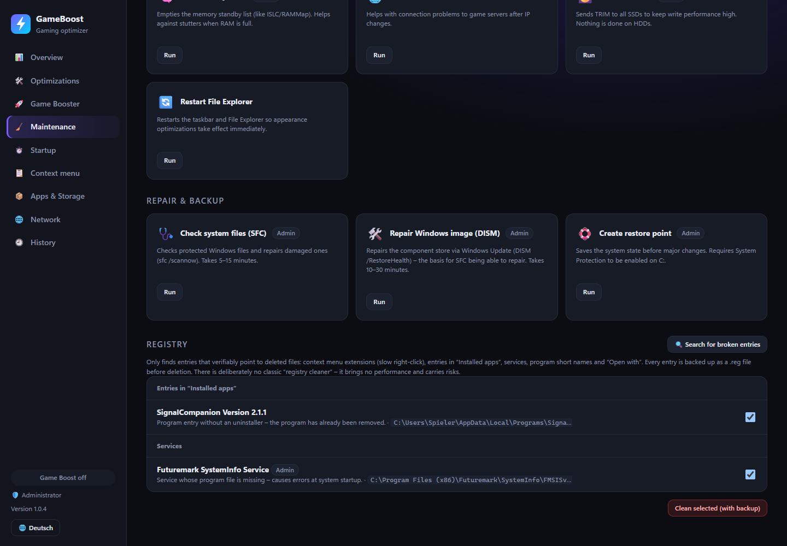
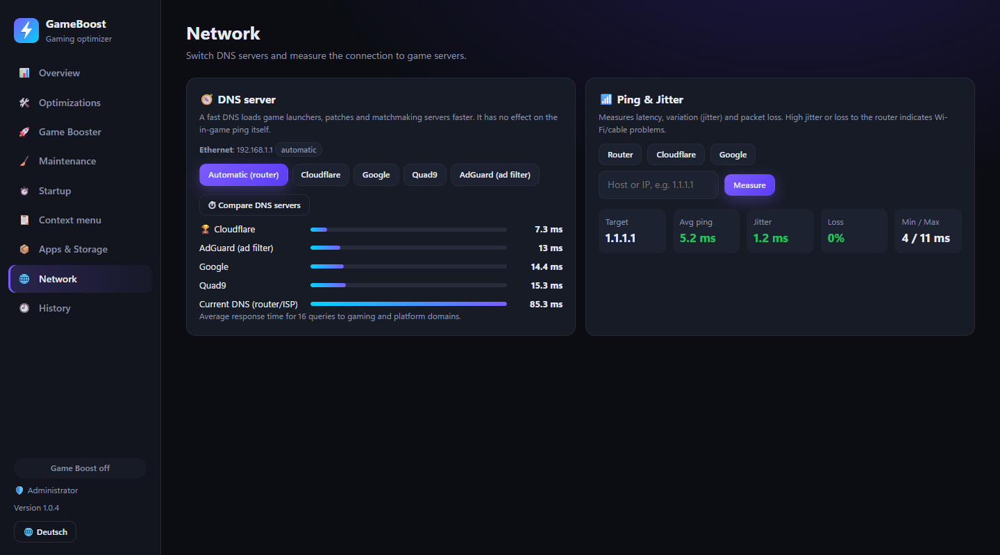

<div align="center">


# GameBoost

**A gaming optimizer for Windows 10/11 – TuneUp-style, but transparent, open source and fully reversible.**

[](https://github.com/Delido/gameboost/releases/latest)
[](https://github.com/Delido/gameboost/releases)

[](LICENSE)



English · **[Deutsch](README.de.md)**

</div>

---

## What GameBoost does

GameBoost bundles the Windows settings that actually matter for games into one app – each with an explanation, a risk level and a switch to undo it. **Every change is backed up first.** On top of that: a system check, a game booster with FPS reports, startup and context menu management, cleanup, uninstaller, registry repair and network tools.

| | |
|---|---|
| 🩺 **System check** | Finds the classic performance killers: monitor running at 60 instead of 144+ Hz, RAM without XMP/EXPO or in single channel, outdated GPU driver, Resizable BAR off, SSD issues, power saver plan active – each with a one-click fix. |
| 🛠️ **57 optimizations** | Gaming (Game Mode, Game DVR, HAGS, MMCSS, MSI mode …), CPU & power (own high-performance plan, core parking, power throttling …), network, mouse & keyboard, services, telemetry & ads, visuals, system. Three profiles: 🟢 Safe · 🟡 Gaming balance · 🔴 Maximum performance. |
| 🚀 **Game Booster** | Pauses services and background apps, switches to the performance plan, frees standby RAM, mutes notifications – and restores everything afterwards. On Intel hybrid CPUs the game runs on the **P-cores** while Discord, browsers & co. move to the E-cores, plus a **0.5 ms timer resolution** while you play. **Auto-Boost** kicks in as soon as a library game runs (also when started from Steam/Epic). |
| 📈 **FPS report** | Records every frame with [PresentMon](https://github.com/GameTechDev/PresentMon) (Intel, open source) and shows average FPS, 1% and 0.1% lows, stutters and GPU-bound share after each session – compared to the previous session of the same game. |
| 🎮 **Game library** | Import from Steam & Epic, high CPU priority and high-performance GPU per game, "Play with boost" – also via right-click on any .exe. |
| ⏱️ **Startup** | Registry, startup folders, scheduled tasks, Store apps and third-party services. Disable like Task Manager or **delete with restore**. Orphaned entries are flagged. |
| 📋 **Context menu** | Classic Windows 11 menu, hide clutter (Share, Clipchamp, Defender …), manage entries of other programs, add "Play with GameBoost" and "Take ownership". |
| 🧹 **Maintenance** | 1-click cleanup, temp/shader/browser caches, Windows.old, WinSxS, crash dumps, SSD TRIM, SFC & DISM – optionally scheduled daily or weekly. |
| 🧩 **Registry** | Finds only entries that verifiably point to deleted files (context menu handlers without DLL, orphaned "Installed apps" entries, services without executable, App Paths, "Open with") – with .reg backup and restore. No heuristic "registry cleaning". |
| 📦 **Apps & storage** | Uninstall programs including leftover search, remove preinstalled Store apps, find large files. Deletion always goes to the Recycle Bin. |
| 🌐 **Network** | Compare and switch DNS servers (Cloudflare, Google, Quad9, AdGuard – original restorable), measure ping, jitter and packet loss. |
| ⏲️ **Benchmark** | Timer latency, system stalls (DPC/interrupts) and CPU performance – compare before and after optimizing. |
| 🖥️ **Tray icon** | Toggle the boost, launch games, run the cleanup, see updates and get the FPS result after every game – optionally started with Windows (no UAC prompts). |
| 🌍 **English / Deutsch** | UI in English or German, defaults to your Windows display language. |

## Installation

### Installer (recommended)

1. **[Download GameBoost-Setup](https://github.com/Delido/gameboost/releases/latest)** (`GameBoost-Setup-x.y.z.exe`)
2. Run it – no admin rights needed, Node.js is included.
3. Start GameBoost from the Start menu (asks for admin rights via UAC).

Or with a PowerShell one-liner:

```powershell
irm https://raw.githubusercontent.com/Delido/gameboost/main/install.ps1 | iex
```

> **Note:** The installer is not code-signed, so Windows SmartScreen shows "Windows protected your PC" on first launch → **More info → Run anyway**.

### Updates

GameBoost checks for new versions on startup and shows an **"Update now"** banner. The update is downloaded from GitHub, verified via SHA-256 and applied without running the installer again. From the command line:

```powershell
gameboost update            # check for updates
gameboost update install    # install the update
```

### Uninstall

Via *Settings → Apps*. The uninstaller asks whether all system changes should be reverted to their original values and removes GameBoost's shortcuts, context menu entries and scheduled tasks.

## Screenshots

<table>
<tr>
<td width="50%"><p align="center"><b>Optimizations</b> – risk level, when it takes effect, undo per item</p></td>
<td width="50%"><p align="center"><b>Game Booster</b> – Auto-Boost, P-cores, library and settings</p></td>
</tr>
<tr>
<td><p align="center"><b>Startup</b> – all sources, publishers, delete with restore</p></td>
<td><p align="center"><b>Context menu</b> – clean up and extend</p></td>
</tr>
<tr>
<td><p align="center"><b>Maintenance</b> – clean, repair, schedule, registry</p></td>
<td><p align="center"><b>Network</b> – DNS comparison and ping/jitter</p></td>
</tr>
</table>

## Safety & undo

- **Everything is reversible:** original values are stored in `%LOCALAPPDATA%\GameBoost\state.json` and are never overwritten when a tweak is applied again. Without a backup, "Revert" restores the Windows default.
- **Risk levels:** *Safe* (no side effects), *Moderate* (small trade-offs, e.g. battery), *Advanced* (deliberate trade-off – e.g. Memory Integrity off; some anti-cheats like Vanguard/FACEIT require it). Profiles and the score leave out matters of taste such as the context menu.
- **Deleted startup entries** (registry value, shortcut or task XML) and **registry repairs** are backed up and can be restored. Context menu entries are only hidden.
- **Files** go to the Recycle Bin; drive roots, the Windows folder and top-level user folders are protected.
- **Restore point:** offered before applying a profile, or `gameboost run restore-point`.
- **Local only:** the UI runs on `127.0.0.1`, protected by a random token. No telemetry – the only outbound connections are the GitHub update check and the one-time PresentMon download.

## Command line

Everything in the UI is also available on the CLI (`gameboost help` lists all commands; CLI output is German). Every command supports `--json`.

```powershell
gameboost status                               # hardware + score
gameboost check                                # system check
gameboost apply --preset balanced --restore-point
gameboost revert --all                         # undo everything
gameboost boost toggle
gameboost games scan | import --all | launch "Counter-Strike 2"
gameboost sessions                             # FPS reports
gameboost startup list | delete "HKCU|Run|Discord" | restore <backupId>
gameboost ctx list | disable "EXT|{…}"
gameboost registry scan | clean <id…> | restore <backupId>
gameboost run quick-clean | sfc | dism-restore
gameboost dns bench | dns set cloudflare | dns set auto
gameboost ping gateway
gameboost autoboost enable
gameboost tray enable                          # tray icon at logon
gameboost schedule set weekly
gameboost profile export --file pc.json
```

When installed, the CLI lives in `%LOCALAPPDATA%\Programs\GameBoost` (`runtime\node.exe bin\gameboost.js …`).

## Raycast extension

For [Raycast for Windows](https://www.raycast.com/) (German UI): optimizations, toggle boost, play with boost, maintenance, profiles, system status with check, startup, context menu, DNS & ping.

```powershell
cd raycast
npm install
npm run dev
```

## Development

Requires Node.js ≥ 20, no other dependencies.

```powershell
git clone https://github.com/Delido/gameboost
cd gameboost
node bin\gameboost.js ui          # start the UI
npm test                          # catalog schema + syntax check of all PowerShell scripts
```

```
bin/gameboost.js     CLI entry point
src/catalog.js       All optimizations (declarative: reg / service / power / custom)
src/engine.js        Detect, apply (with backup), revert – compiled into one PowerShell script
src/actions.js       Maintenance actions               src/registry.js    Registry repair
src/boost.js         Boost session + watcher           src/session.js     P-cores, timer, PresentMon, FPS report
src/autoboost.js     Auto-Boost watcher                src/tray.js        Tray icon
src/games.js         Game library, Steam/Epic scan     src/checks.js      System check
src/startup.js       Startup manager                   src/contextmenu.js Context menu manager
src/apps.js          Programs, leftovers, Store apps   src/files.js       Large files, Recycle Bin
src/network.js       DNS, ping                         src/bench.js       Benchmark
src/schedule.js      Scheduled tasks                   src/profile.js     Export/import
src/update.js        Updater (GitHub releases)         src/server.js      Local UI server
src/i18n.js          Language, English catalog texts   ui/                UI (HTML/CSS/JS, i18n)
installer/           Inno Setup script                 test/              Tests
```

To add an optimization, add an entry to `src/catalog.js` (and its English text to `src/i18n/en.js`) – UI, CLI and Raycast pick it up automatically; `npm test` checks schema and PowerShell syntax.

### Releasing

1. Bump `version` in `package.json` and commit.
2. Push a tag: `git tag v1.2.3 && git push origin v1.2.3`
3. The [`release.yml`](.github/workflows/release.yml) workflow runs the tests, builds `GameBoost-Setup-1.2.3.exe` (with Node.js) and `gameboost-1.2.3.zip` (for the updater) and publishes the release. Installed copies then show the update banner.

## License

[MIT](LICENSE) – use at your own risk. GameBoost changes system settings; all changes are documented and reversible, but creating a restore point before bigger changes is recommended. PresentMon is © Intel Corporation (MIT), downloaded on first use.
