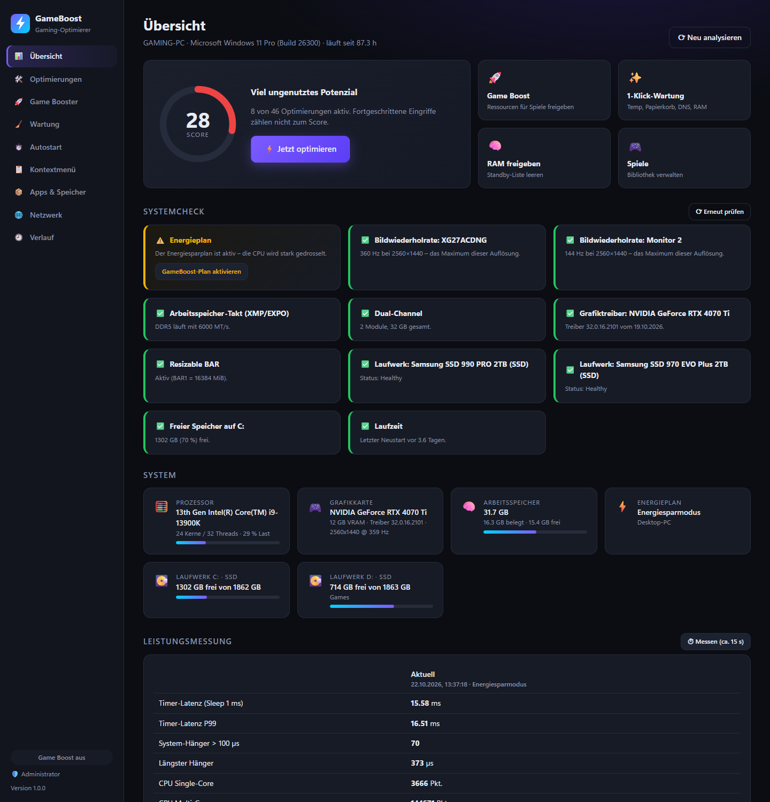
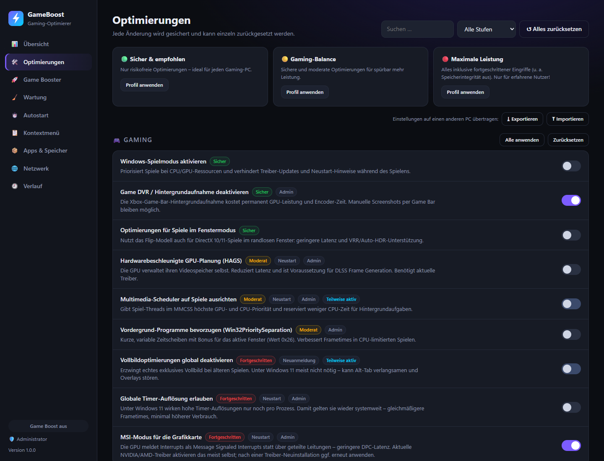
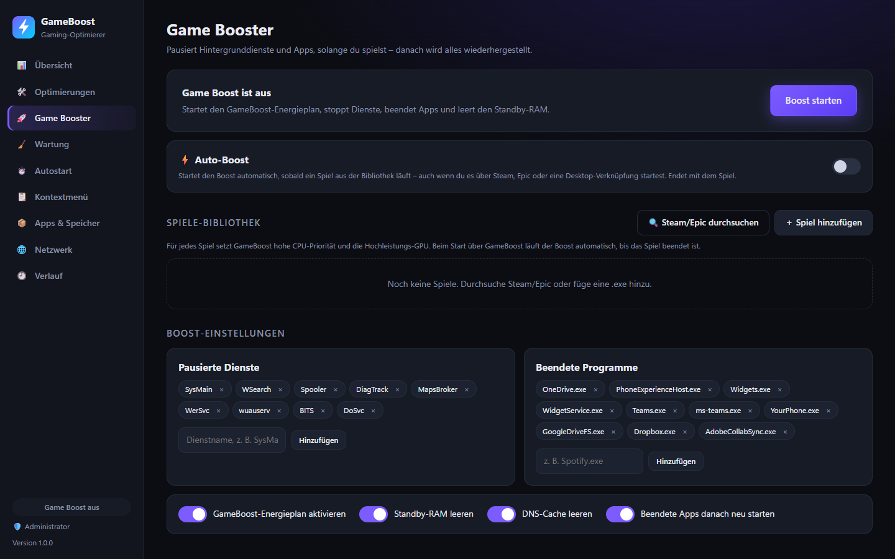
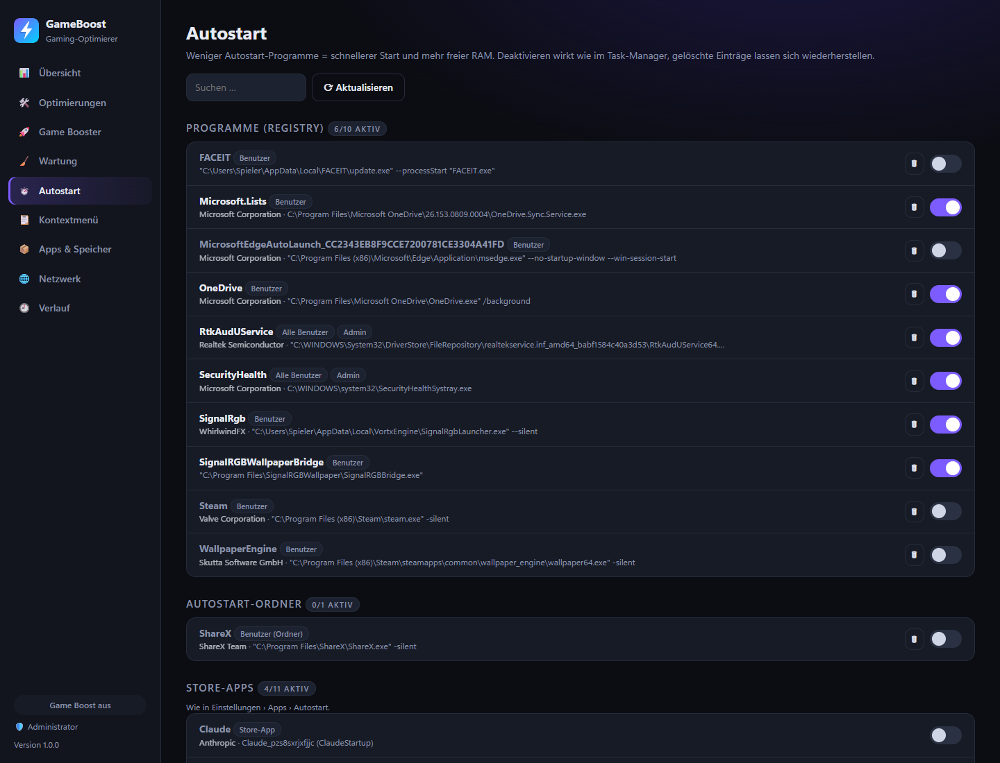
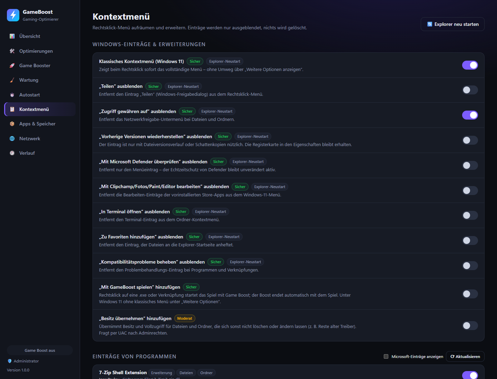
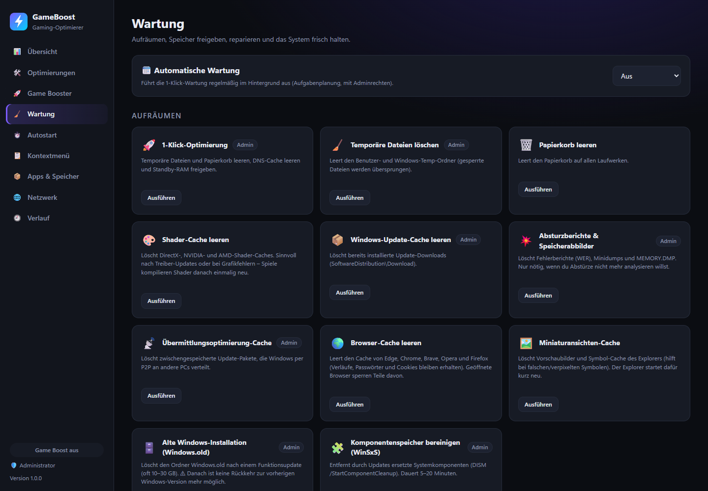
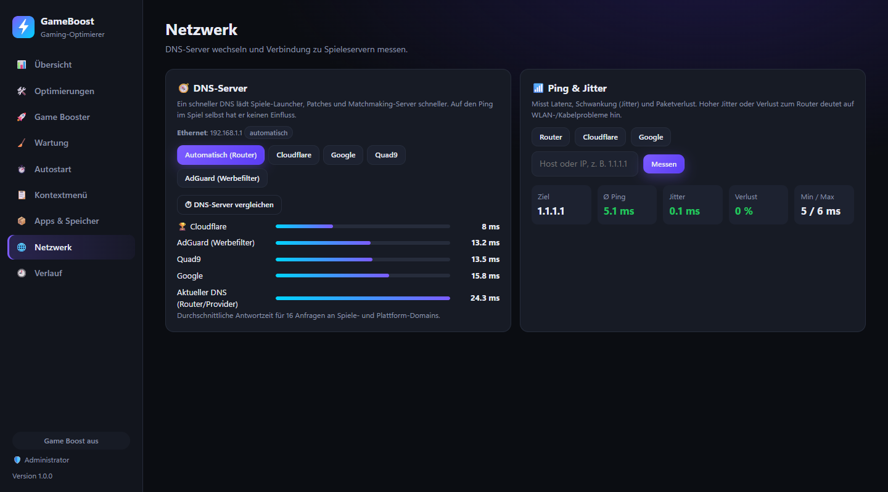
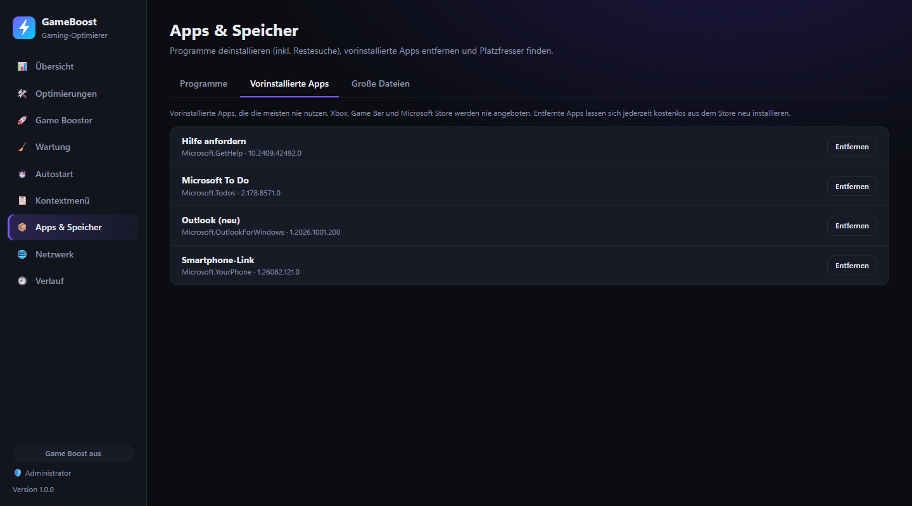

<div align="center">


# GameBoost

**Gaming-Optimierer für Windows 10/11 – im Stil von TuneUp, aber transparent, quelloffen und vollständig umkehrbar.**

[](https://github.com/Delido/gameboost/releases/latest)
[](https://github.com/Delido/gameboost/releases)

[](LICENSE)



</div>

---

## Was GameBoost macht

GameBoost bündelt die Windows-Einstellungen, die für Spiele wirklich etwas bringen, in einer Oberfläche – mit Erklärung, Risikostufe und einem Schalter zum Zurücksetzen. **Jede Änderung wird vorher gesichert.** Dazu kommen Systemcheck, Game Booster, Autostart- und Kontextmenü-Verwaltung, Aufräumen, Deinstallieren und Netzwerk-Tools.

| | |
|---|---|
| 🩺 **Systemcheck** | Findet typische Leistungsbremsen: Monitor läuft mit 60 statt 144+ Hz, RAM ohne XMP/EXPO oder in Single-Channel, alter GPU-Treiber, Resizable BAR aus, SSD-Probleme, Energiesparplan aktiv – jeweils mit Lösung per Klick. |
| 🛠️ **57 Optimierungen** | Gaming (Spielmodus, Game DVR, HAGS, MMCSS, MSI-Modus …), CPU & Energie (eigener Höchstleistungsplan, Core Parking, Power Throttling …), Netzwerk, Maus & Tastatur, Dienste, Telemetrie & Werbung, Darstellung, System. Drei Profile: 🟢 Sicher · 🟡 Gaming-Balance · 🔴 Maximale Leistung. |
| 🚀 **Game Booster** | Pausiert Dienste und Hintergrund-Apps, aktiviert den Leistungsplan, leert Standby-RAM – und stellt danach alles wieder her. **Auto-Boost** startet automatisch, sobald ein Spiel aus der Bibliothek läuft (auch über Steam/Epic). |
| 🎮 **Spiele-Bibliothek** | Import aus Steam & Epic, hohe CPU-Priorität und Hochleistungs-GPU pro Spiel, „Spielen mit Boost“ – auch per Rechtsklick auf jede .exe. |
| ⏱️ **Autostart** | Registry, Autostart-Ordner, geplante Aufgaben, Store-Apps und Dienste von Drittanbietern. Deaktivieren wie im Task-Manager oder **löschen mit Wiederherstellung**. Verwaiste Einträge werden markiert. |
| 📋 **Kontextmenü** | Klassisches Windows-11-Menü, überflüssige Einträge ausblenden (Teilen, Clipchamp, Defender …), Einträge anderer Programme verwalten, „Mit GameBoost spielen“ und „Besitz übernehmen“ hinzufügen. |
| 🧹 **Wartung** | 1-Klick-Wartung, Temp-/Shader-/Browser-Cache, Windows.old, WinSxS, Absturzberichte, SSD-TRIM, SFC & DISM – auf Wunsch automatisch täglich oder wöchentlich. |
| 📦 **Apps & Speicher** | Programme deinstallieren inkl. Restesuche, vorinstallierte Store-Apps entfernen, große Dateien finden. Gelöscht wird immer in den Papierkorb. |
| 🌐 **Netzwerk** | DNS-Server vergleichen und umstellen (Cloudflare, Google, Quad9, AdGuard – Original wiederherstellbar), Ping, Jitter und Paketverlust messen. |
| ⏲️ **Leistungsmessung** | Timer-Latenz, System-Hänger (DPC/Interrupts) und CPU-Leistung – vor und nach dem Optimieren vergleichen. |

## Installation

### Installer (empfohlen)

1. **[GameBoost-Setup herunterladen](https://github.com/Delido/gameboost/releases/latest)** (`GameBoost-Setup-x.y.z.exe`)
2. Ausführen – keine Adminrechte nötig, Node.js ist enthalten.
3. GameBoost über das Startmenü starten (fragt per UAC nach Adminrechten).

Oder per PowerShell-Einzeiler:

```powershell
irm https://raw.githubusercontent.com/Delido/gameboost/main/install.ps1 | iex
```

> **Hinweis:** Der Installer ist nicht signiert. Windows SmartScreen zeigt deshalb beim ersten Start „Der Computer wurde durch Windows geschützt“ → **Weitere Informationen → Trotzdem ausführen**.

### Updates

GameBoost prüft beim Start auf neue Versionen und zeigt ein Banner mit **„Jetzt aktualisieren“**. Das Update wird von GitHub geladen, per SHA-256 geprüft und ohne erneuten Installer eingespielt. In der Kommandozeile:

```powershell
gameboost update            # nach Updates suchen
gameboost update install    # Update installieren
```

### Deinstallation

Über *Einstellungen → Apps*. Der Deinstaller fragt, ob alle Systemänderungen auf die ursprünglichen Werte zurückgesetzt werden sollen, und entfernt Verknüpfungen, Kontextmenü-Einträge und geplante Aufgaben von GameBoost.

## Screenshots

<table>
<tr>
<td width="50%"><p align="center"><b>Optimierungen</b> – mit Risikostufe, Wirkungszeitpunkt und Einzel-Rücksetzen</p></td>
<td width="50%"><p align="center"><b>Game Booster</b> – Auto-Boost, Spiele-Bibliothek und Einstellungen</p></td>
</tr>
<tr>
<td><p align="center"><b>Autostart</b> – alle Quellen, Herausgeber, Löschen mit Wiederherstellung</p></td>
<td><p align="center"><b>Kontextmenü</b> – aufräumen und erweitern</p></td>
</tr>
<tr>
<td><p align="center"><b>Wartung</b> – aufräumen, reparieren, automatisch planen</p></td>
<td><p align="center"><b>Netzwerk</b> – DNS-Vergleich und Ping/Jitter</p></td>
</tr>
<tr>
<td><p align="center"><b>Apps &amp; Speicher</b> – vorinstallierte Apps entfernen</p></td>
<td></td>
</tr>
</table>

## Sicherheit & Rücksetzen

- **Alles umkehrbar:** Originalwerte liegen in `%LOCALAPPDATA%\GameBoost\state.json`. Beim erneuten Anwenden wird nie der ursprüngliche Wert überschrieben. Ohne Backup setzt „Zurücksetzen“ auf den Windows-Standard zurück.
- **Risikostufen:** *Sicher* (keine Nebenwirkungen), *Moderat* (kleine Kompromisse, z. B. Akku), *Fortgeschritten* (bewusste Abwägung – z. B. Speicherintegrität aus; manche Anti-Cheats wie Vanguard/FACEIT setzen sie voraus). Profile und Score enthalten Geschmackssachen wie das Kontextmenü nicht.
- **Gelöschte Autostart-Einträge** (Registry-Wert, Verknüpfung oder Aufgaben-XML) werden gesichert und lassen sich wiederherstellen. Kontextmenü-Einträge werden nur ausgeblendet.
- **Dateien** landen im Papierkorb; Laufwerkswurzeln, der Windows-Ordner und Benutzer-Hauptordner sind gesperrt.
- **Wiederherstellungspunkt:** Vor größeren Änderungen anbieten lassen (Profil-Dialog) oder `gameboost run restore-point`.
- **Lokal:** Die Oberfläche läuft nur auf `127.0.0.1`, geschützt durch ein Zufalls-Token. Keine Telemetrie – die einzige Verbindung nach außen ist die Update-Prüfung bei GitHub.

## Kommandozeile

Alles aus der Oberfläche geht auch per CLI (`gameboost help` zeigt alle Befehle). Jeder Befehl unterstützt `--json`.

```powershell
gameboost status                               # Hardware + Score
gameboost check                                # Systemcheck
gameboost apply --preset balanced --restore-point
gameboost revert --all                         # Alles zurücksetzen
gameboost boost toggle
gameboost games scan | import --all | launch "Counter-Strike 2"
gameboost startup list | delete "HKCU|Run|Discord" | restore <backupId>
gameboost ctx list | disable "EXT|{…}"
gameboost run quick-clean | sfc | dism-restore
gameboost dns bench | dns set cloudflare | dns set auto
gameboost ping gateway
gameboost autoboost enable
gameboost schedule set weekly
gameboost profile export --file pc.json
```

Installiert liegt die CLI unter `%LOCALAPPDATA%\Programs\GameBoost` (`runtime\node.exe bin\gameboost.js …`).

## Raycast-Extension

Für [Raycast for Windows](https://www.raycast.com/): Optimierungen, Game Boost umschalten, Spiel mit Boost starten, Wartung, Profile, System-Status mit Systemcheck, Autostart, Kontextmenü sowie DNS & Ping.

```powershell
cd raycast
npm install
npm run dev
```

Den GameBoost-Ordner findet die Extension automatisch (`%LOCALAPPDATA%\GameBoost\location.json`); optional in den Extension-Einstellungen festlegen.

## Entwicklung

Voraussetzung: Node.js ≥ 20, keine weiteren Abhängigkeiten.

```powershell
git clone https://github.com/Delido/gameboost
cd gameboost
node bin\gameboost.js ui          # Oberfläche starten
node bin\gameboost.js install     # Startmenü-Verknüpfung auf diesen Ordner
npm test                          # Katalog-Schema + Syntaxprüfung aller PowerShell-Skripte
```

```
bin/gameboost.js     CLI-Einstieg
src/catalog.js       Alle Optimierungen (deklarativ: reg / service / power / custom)
src/engine.js        Erkennen, Anwenden (mit Backup), Zurücksetzen – kompiliert zu einem PowerShell-Skript
src/actions.js       Wartungsaktionen
src/boost.js         Game-Boost-Session + Watcher        src/autoboost.js   Auto-Boost-Wächter
src/games.js         Spiele-Bibliothek, Steam/Epic-Scan  src/checks.js      Systemcheck
src/startup.js       Autostart                           src/contextmenu.js Kontextmenü-Manager
src/apps.js          Programme, Restesuche, Store-Apps   src/files.js       Große Dateien, Papierkorb
src/network.js       DNS, Ping                           src/bench.js       Leistungsmessung
src/schedule.js      Geplante Aufgaben                   src/profile.js     Export/Import
src/update.js        Updater (GitHub Releases)           src/server.js      Lokaler Server der Oberfläche
ui/                  Oberfläche (HTML/CSS/JS)            raycast/           Raycast-Extension
installer/           Inno-Setup-Skript                   test/              Tests
```

Neue Optimierung hinzufügen: einen Eintrag in `src/catalog.js` ergänzen – Oberfläche, CLI und Raycast zeigen ihn automatisch an, `npm test` prüft Schema und PowerShell-Syntax.

### Release erstellen

1. `version` in `package.json` erhöhen und committen.
2. Tag pushen: `git tag v1.2.3 && git push origin v1.2.3`
3. Der Workflow [`release.yml`](.github/workflows/release.yml) testet, baut `GameBoost-Setup-1.2.3.exe` (inkl. Node.js) und `gameboost-1.2.3.zip` (für den Updater) und veröffentlicht das Release. Installierte Versionen zeigen danach das Update-Banner.

## Lizenz

[MIT](LICENSE) – Nutzung auf eigene Verantwortung. GameBoost ändert Systemeinstellungen; alle Änderungen sind dokumentiert und umkehrbar, trotzdem empfiehlt sich vor größeren Eingriffen ein Wiederherstellungspunkt.
